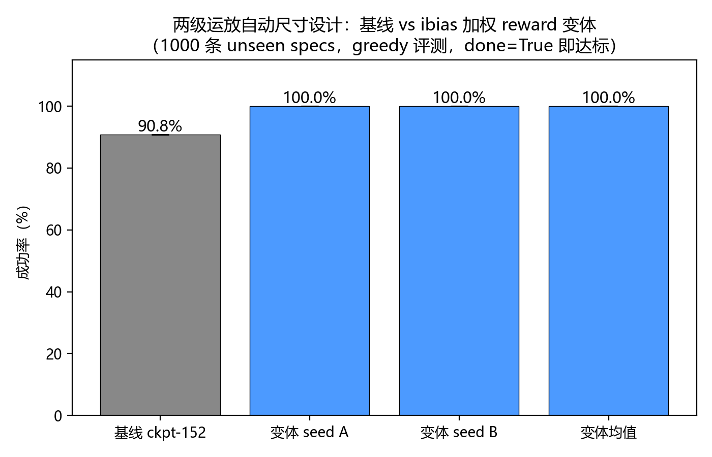
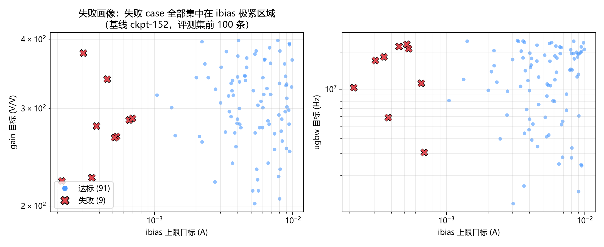
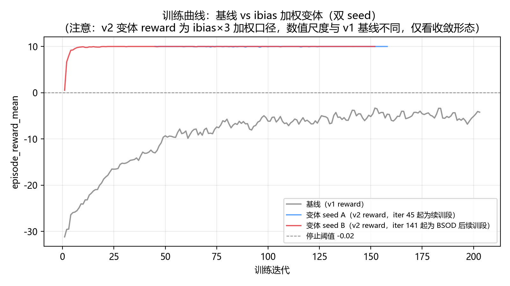

# AutoCkt-RL: 基于深度强化学习的两级运放自动尺寸设计（复现 + Reward Shaping 改进）

> 将模拟电路尺寸设计建模为 MDP，用 PPO + NGSpice 仿真闭环训练智能体自动搜索器件参数。
> 通过**失败画像驱动的 reward shaping 消融对照实验**，在 1000 条独立 unseen specs 评测集上
> 把设计成功率从 **90.8% 提升到 100.0%（双 seed 零方差复现）**，达标速度提升约 **15 倍**。

本项目基于 UC Berkeley 的 AutoCkt（[*Deep Reinforcement Learning of Analog Circuit Designs*, DATE 2020](https://arxiv.org/abs/2001.01808)）开源代码复现，
并在此之上完成了可复现评测基建、失败归因分析与 reward shaping 对照改进。
（原始仓库 README 见 [README_UPSTREAM.md](README_UPSTREAM.md)）

## 核心结果（1000 条 unseen specs 独立评测集，greedy 评测，done=True 口径）

| 指标 | 基线 ckpt-152 | 变体 seed A | 变体 seed B |
|---|---|---|---|
| 成功率 | 90.8%（908/1000） | **100.0%** | **100.0%** |
| 平均达标步数 | 14.9 | **1.00（一步直达）** | **1.00（一步直达）** |

- 失败率 9.2% → 0；两个独立随机种子完全复现。
- 基线 92 个失败 case **100% 失守 ibias_max**（紧电流预算场景）；变体把这批硬 case 全部攻克，
  落点 ibias 比最紧目标低 2.7 倍、gain 余量 4~7 倍——验证了"加权 shaping → 低电流设计区"的物理机制假设。
- 严谨口径：评测集与论文不同，**不与论文 80–96% 直接对比**，仅做同协议基线↔变体对照。



## 方法

### MDP 建模
- **状态**：4 项性能指标（gain / ibias_max / phm / ugbw）相对目标的归一化偏差 + 目标 spec + 当前 7 维参数索引
- **动作**：7 个器件参数的离散微调（Tuple 空间，每参数 -1/0/+2 三档）
- **奖励**：satisficing 口径——仅惩罚未达标维度（达标维度截断），全部满足 +10 并终止 episode

### 训练管线
Ray/RLlib PPO（fcnet 256×256，4 rollout workers 并行 NGSpice 仿真，LR 5e-5），
每个训练 step 与 SPICE 仿真器闭环交互，约 150 迭代收敛（每迭代 ~11 分钟，单 seed 约 25–30 小时）。

### 改进：失败画像驱动的 Reward Shaping 消融
1. **失败画像**：基线在 100 条子集上 91% 成功率，9 个失败 case 全部失守 ibias_max（100%），
   根因是 agent 收敛到"满配"设计点，ibias ≈ 8.4e-4 必然越过紧电流目标；
2. **变体设计**：仅对 ibias 维度惩罚 ×3 加权——**达标判定逻辑与基线逐位一致**，保证对照实验严谨性；
3. **对照验证**：同协议（同一 1000 条评测集、greedy、done=True 口径）下双 seed 训练、双 seed 评测。




## 仓库结构

```
├── autockt/                    # RL 主体
│   ├── envs/
│   │   ├── ngspice_vanilla_opamp.py    # 基线环境 v1（复现原论文）
│   │   └── ngspice_vanilla_opamp_v2.py # 变体环境 v2（仅 reward shaping 不同）
│   ├── val_autobag_ray.py      # 基线训练脚本
│   ├── val_autobag_ray_v2.py   # 变体训练脚本（支持 --seed / --stop_iters / checkpoint 续训）
│   ├── rollout.py              # 评测器（--specs_file / --out_prefix / CSV 落盘 / 断点续评）
│   └── gen_specs.py            # 评测/训练 spec 采样
├── eval/                       # 评测基建 ★
│   ├── EVAL_PROTOCOL.md        #   评测协议（成功判据、评测集、对照规范）
│   ├── REWARD_VARIANT_DESIGN.md#   变体设计文档（假设、控制变量、diff）
│   ├── TIMING_CALIBRATION.md   #   计时标定 + 环境坑备忘
│   ├── analyze_failures.py     #   失败归因分析工具
│   └── results/                #   三方 1000 条逐条评测 CSV（可复算）
├── eval_engines/               # NGSpice 仿真引擎（含可靠性补丁）
├── docs/
│   └── figures/                  # fig1 成功率对比 / fig2 失败画像 / fig3 训练曲线
├── backup_20261112/            # 全部工程补丁前的原始代码备份
```

## 快速开始

### 环境
```bash
conda env create -f environment.yml      # Python 3.7 + Ray/RLlib + TF1.x
conda activate autockt
# NGSpice 2.7 需单独安装：https://sourceforge.net/projects/ngspice/files/ng-spice-rework/old-releases/27/
python eval_engines/ngspice/ngspice_inputs/correct_inputs.py   # 修正 netlist 库路径
```

> ⚠️ **环境坑备忘**：在本机某些终端（如注入过 PYTHONPATH shim 的 shell）中运行会触发
> `TypeError: unlink() got an unexpected keyword argument 'missing_ok'`（Python 3.7 与 3.8+ shim 不兼容）。
> 所有命令加前缀即可规避：`env -u PYTHONPATH <python> ...`

### 训练
```bash
# 基线
python -m autockt.val_autobag_ray
# 变体（支持指定 seed 与停止迭代数）
python -m autockt.val_autobag_ray_v2 --seed 100 --stop_iters 152
# 断点续训（checkpoint 传文件前缀，不是目录！）
python -m autockt.val_autobag_ray_v2 --seed 100 --checkpoint_dir "<ray_results>/<trial>/checkpoint_000140/checkpoint-140"
```
（注意用 `python -m` 方式运行，直接跑脚本会找不到 `autockt` 包。）

### 评测
```bash
# 先准备独立评测集（务必加 _eval 后缀，避免覆盖训练集！）
python -c "from autockt.gen_specs import gen_data; gen_data('eval_engines/ngspice/ngspice_inputs/yaml_files/two_stage_opamp.yaml', 'two_stage_opamp_eval', 1000)"
# 全量评测（greedy、done=True 口径、逐条 CSV 落盘）
env -u PYTHONPATH python autockt/rollout.py "<checkpoint路径>" --run PPO --env two_stage_opamp \
  --num_val_specs 1000 --traj_len 60 \
  --specs_file "autockt/gen_specs/ngspice_specs_gen_two_stage_opamp_eval" \
  --out_prefix my_eval --no-render
# 失败归因分析
python eval/analyze_failures.py   # 详见脚本内用法
```

评测所用的 checkpoint 在训练机器本地（ray_results 体积约 20GB，未入库）：
- 基线：`~/ray_results/train_45nm_ngspice/.../checkpoint_000152`
- 变体 seed A：`~/ray_results/restore_ppo/PPO_TwoStageAmpV2_4824a_*/checkpoint_000158`
- 变体 seed B：`D:/ray_results/restore_ppo/PPO_TwoStageAmpV2_dca2e_*/checkpoint_000152`

## 工程可靠性（9 个真实 debugging 故事）

本项目在 Windows + 老版本 RLlib/TF 的脆弱组合上做了系统性加固，最具代表性的：

1. **评测判据修正**：`reward_total>=9` 会误杀"先扣分后达标"的 near-miss（10 条中误杀 3 条），改为论文口径 `done=True`；
2. **评测确定性**：`compute_action` 默认随机采样导致同 checkpoint 两次评测不一致，改 `explore=False` greedy 后逐条复现；
3. **NGSpice 静默挂死自愈**：仿真进程偶发挂死死锁全部 worker → `subprocess` 60s 超时 + 失败降级返回最差 specs；
4. **观测空间越界**：不稳定电路 phm<0 导致归一化值越界杀死 RLlib worker → 返回前 clip 到空间边界；
5. **BSOD 后系统进程创建劣化**：蓝屏后 worker 注册超时 → `RAY_worker_register_timeout_seconds=900` 绕过；
6. **训练中断无损恢复**：checkpoint 每迭代落盘，崩溃/暂停/蓝屏均从断点续训。

## 已知限制

- 评测集为本项目独立采样，与论文 spec 分布不同，结果不与论文直接对比；
- 代码运行于 Python 3.7 + RLlib 1.13 + TF1.x 旧栈，不建议升级（升级会破坏可复现性）；
- 训练 checkpoint 与仿真缓存未入库（体积原因），见"快速开始"中的本地路径。

## 致谢与参考

- 原论文：K. Kunal et al., *Deep RL of Analog Circuit Designs*, DATE 2020. [arXiv:2001.01808](https://arxiv.org/abs/2001.01808)
- 原始代码：[AutoCkt (Berkeley)](https://github.com/kunal001/AutoCkt)（本仓库基于其复现并扩展）
